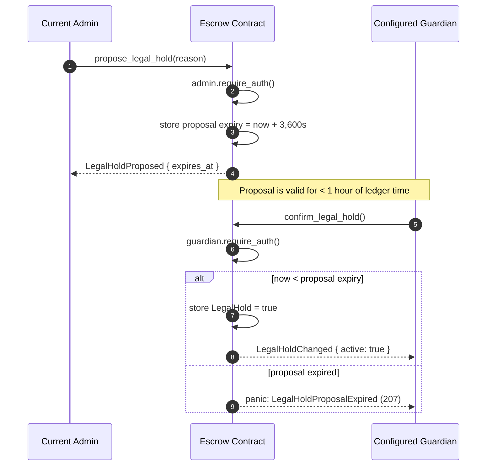

# Escrow Legal Hold — Security Reference

`DataKey::LegalHold` is a boolean compliance gate stored in contract instance
storage. When `true` it blocks every risk-bearing state transition. This
document describes the gated operations, the enforcement model, governance
expectations, and explicit out-of-scope items.

---

## Gated operations

| Function | Panic message when hold is active |
|---|---|
| `fund` | `Legal hold blocks new funding while active` |
| `fund_with_commitment` | `Legal hold blocks new funding while active` |
| `settle` | `Legal hold blocks settlement finalization` |
| `withdraw` | `Legal hold blocks SME withdrawal` |
| `claim_investor_payout` | `Legal hold blocks investor claims` |
| `sweep_terminal_dust` | `Legal hold blocks treasury dust sweep` |

All six checks call the private `legal_hold_active(&env)` helper, which reads
`DataKey::LegalHold` from instance storage and defaults to `false` when the key
is absent. The check is the **first** assertion in each function body, so no
partial state mutation can occur before the gate fires.

Operations that are **not** gated (read-only or metadata-only):

- `get_*` accessors
- `record_sme_collateral_commitment` (metadata record, no token movement)
- `bind_primary_attestation_hash` / `append_attestation_digest`
- `update_maturity`, `update_funding_target`, `propose_admin`, `accept_admin`, `migrate`

---

## Guardian two-step legal hold flow

When an escrow is initialized with `init_with_guardian`, activating a hold is a
two-step process: the current admin **proposes** and the configured guardian
**confirms**. Neither party can activate a hold alone. The legacy one-step
`set_legal_hold(true, ...)` and `set_legal_hold_multisig(..., true, ...)` paths
reject guardian-configured escrows.

### Sequence diagram



### Worked example (CLI)

```bash
# 1. Admin proposes the hold (starts the one-hour window).
stellar contract invoke \
  --id $ESCROW_ID --source $ADMIN_KEY \
  -- propose_legal_hold --reason "court order 2024-118"

# 2. Guardian confirms before the proposal expires.
stellar contract invoke \
  --id $ESCROW_ID --source $GUARDIAN_KEY \
  -- confirm_legal_hold

# 3. Verify the hold is active.
stellar contract invoke \
  --id $ESCROW_ID --source $ANY_KEY \
  -- get_legal_hold
```

### Proposal expiry

A pending proposal is valid for **less than one hour** of ledger time
(`now + 3,600` seconds at proposal time). Confirmation after that boundary is
rejected with error **207** (`LegalHoldProposalExpired`). The admin may replace
a pending proposal at any time by calling `propose_legal_hold` again, which
resets the expiry window; an expired proposal cannot be confirmed and must be
re-proposed.

### Authority mismatch

Each step enforces a distinct authorization:

- `propose_legal_hold` requires the **current admin** signature. A guardian
  calling it, or any other signer, fails with error **208**
  (`LegalHoldProposalUnauthorized`).
- `confirm_legal_hold` requires the **configured guardian** signature. The
  admin (or any other signer) confirming fails with error **209**
  (`LegalHoldConfirmUnauthorized`).
- Confirming when no proposal is pending fails with error **210**
  (`NoPendingLegalHoldProposal`).

These errors are distinct from the legacy one-step path, which rejects
guardian-configured escrows outright rather than accepting a proposal.

---

## Enforcement model

```
No guardian (legacy init)
   └─ set_legal_hold(true, reason)
     └─ escrow.admin.require_auth()
     └─ stores LegalHold = true

Guardian configured (init_with_guardian)
   └─ propose_legal_hold(admin)
     └─ current admin authorization
     └─ stores proposal expiry = ledger timestamp + 3,600 seconds
   └─ confirm_legal_hold(guardian)
     └─ configured guardian authorization
     └─ requires current timestamp < proposal expiry
     └─ stores LegalHold = true

request_clear_legal_hold()
    └─ escrow.admin.require_auth()
    └─ storage().instance().set(DataKey::LegalHoldClearableAt, now + delay)
    └─ emits LegalHoldClearRequested { clearable_at }

clear_legal_hold()
    └─ delegates to set_legal_hold(false)   ← same auth path, no shortcut
```

Key properties:

- **Activation roles.** Without a configured guardian, only the current admin
  activates a hold in one step. With a guardian, activation requires a current
  admin proposal and confirmation by the configured guardian. Both the legacy
  `set_legal_hold(true, ...)` and `set_legal_hold_multisig(..., true, ...)`
  immediate activation paths reject guardian-configured escrows.
- **Proposal expiry.** A pending proposal is valid for less than one hour of
  ledger time. The admin may replace a pending proposal; an expired proposal
  cannot be confirmed.
- **Clearance unchanged.** The current admin alone clears a hold, subject to
  any configured clear delay. Guardian approval is not required for clearance.
- **Atomic.** The hold is read and checked before any storage mutation in each
  gated function. There is no window between the check and the effect.
- **Persistent across state transitions.** The hold is stored independently of
  `InvoiceEscrow::status`. A hold set while the escrow is open remains active
  after it becomes funded; a hold set after settlement blocks investor claims.
- **Controlled-clear semantics.** When a hold-clear delay is configured,
  `request_clear_legal_hold` must be called first and `set_legal_hold(false)` is
  only allowed once the ledger timestamp has reached the returned boundary.
- **Idempotent.** In legacy mode, repeated `set_legal_hold` calls are no-ops
  for state but still require admin auth and emit an event. In guardian mode,
  activation requires a fresh proposal and confirmation; repeated confirmation
  without a pending proposal is rejected. Clearing remains admin-authorized.
- **Default off.** `legal_hold_active` returns `false` when the key has never
  been written, so newly deployed escrows are not accidentally frozen.

---

## Governance expectations

The optional guardian reduces the risk of a compromised admin key causing an
immediate freeze, but it is not a replacement for governance. Production
deployments must treat `admin` as a governed address and protect the guardian
key independently:

- **Multisig wallet** (e.g. Stellar multisig account with M-of-N signers) so
  no single key can freeze funds indefinitely.
- **Protocol DAO contract** that requires an on-chain vote before calling
  `set_legal_hold`.
- **Off-chain playbook** covering: who may initiate a hold, required evidence,
  maximum hold duration, escalation path if the admin key is lost or
  compromised, and emergency recovery via `propose_admin` + `accept_admin`
  with governance approval.
- **On-chain cooling-off window** when configured: `request_clear_legal_hold`
  schedules a ledger-time boundary before `set_legal_hold(false)` may unfreeze.
  When a non-zero delay is configured, `set_legal_hold(false)` will fail until
  the clear request has been made and the ledger time has reached the stored
  `LegalHoldClearableAt` value.

Without a guardian, a compromised admin key can freeze all investor funds
immediately. With a guardian, compromise of both independent keys is required
for immediate activation. A hold already active remains clearable by the admin.

### Required deployment posture

| Requirement | Rationale |
|---|---|
| Governed `admin` at `init` (multisig or DAO contract) | Limits freeze and recovery risk |
| Independent guardian key when configured | Prevents admin-only immediate hold activation |
| Documented recovery playbook | Operators must know how to execute `propose_admin` and `accept_admin` under hold |
| Testnet rotation drill before mainnet | Confirms new admin can `clear_legal_hold` after rotation |
| Indexer monitoring of `LegalHoldChanged` | Detect holds that exceed policy duration |

See [ADR-004](adr/ADR-004-legal-hold.md) and [`OPERATOR_RUNBOOK.md`](OPERATOR_RUNBOOK.md)
§7–§8 for upgrade-window coordination and admin key hygiene.

---

## Failure mode: hold + lost admin key

When `DataKey::LegalHold` is `true` and the **current** admin signing key is
lost or destroyed:

- `settle`, `withdraw`, `claim_investor_payout`, `fund`, and
  `sweep_terminal_dust` remain blocked.
- `clear_legal_hold` requires authorization from whoever is stored as
  `InvoiceEscrow::admin` — the lost key cannot satisfy this.
- There is no protocol-level bypass. A configured guardian participates only
  in hold activation; it cannot recover a lost admin key or clear an active hold.

**On-chain recovery (only path):**

1. Governance executes [`propose_admin`](../../escrow/src/lib.rs) using a
   **still-available** current-admin authorization (e.g. remaining multisig
   signers or DAO vote output). This entrypoint is **not** blocked by the hold.
2. The proposed successor executes [`accept_admin`](../../escrow/src/lib.rs)
   with its own authorization. This promotes the successor into
   `InvoiceEscrow::admin` and clears `DataKey::PendingAdmin`.
3. The **new** admin calls `clear_legal_hold` (or `set_legal_hold(false)`).
4. Risk-bearing flows resume (`settle`, `withdraw`, etc.).

**Invariant:** a hold is always clearable by the current admin; recovery
requires controlling admin authority — not merely controlling the SME or
treasury roles.

If governance cannot produce a valid current-admin signature for
`propose_admin`, funds remain locked until off-chain legal or operational
recovery restores signing capability. If a proposal was created with the wrong
address, the current admin can overwrite it by calling `propose_admin` again.
This is why single-signer production admins are prohibited.

---

## Admin rotation during a hold

`propose_admin` and `accept_admin` are not gated by the hold. This is
intentional: if the current admin is compromised or unresponsive, governance
must be able to rotate the admin key even while a hold is active. The handover
still requires both the current admin and successor to authorize the change.
